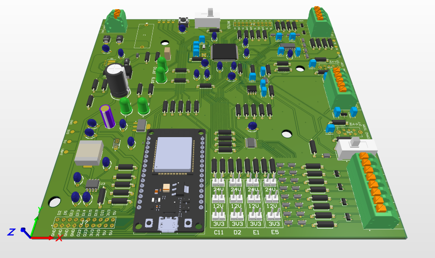
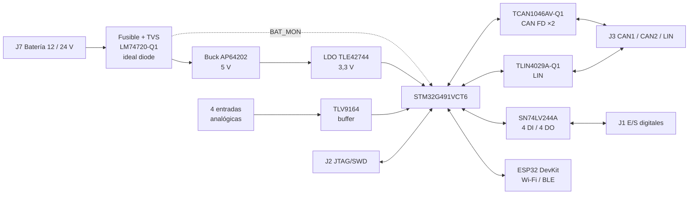
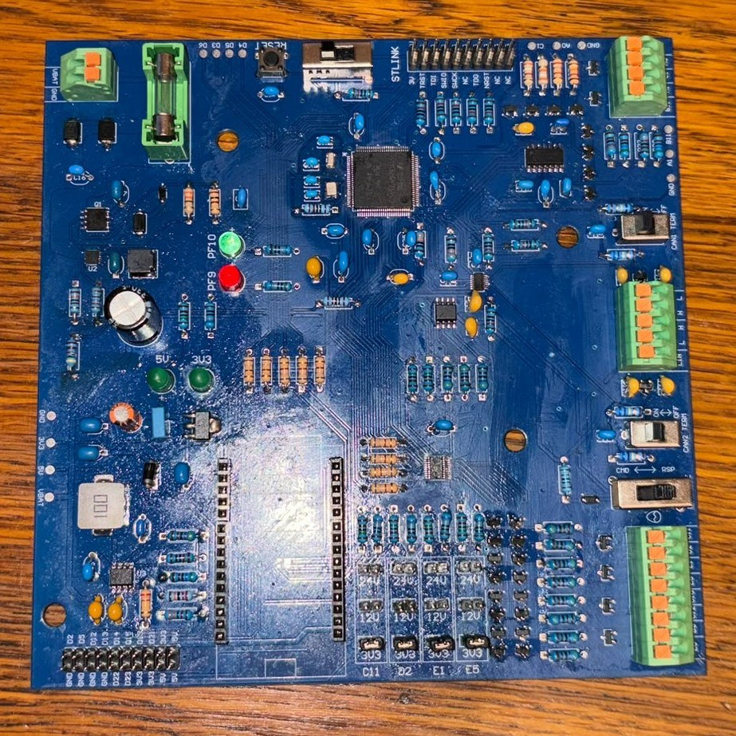
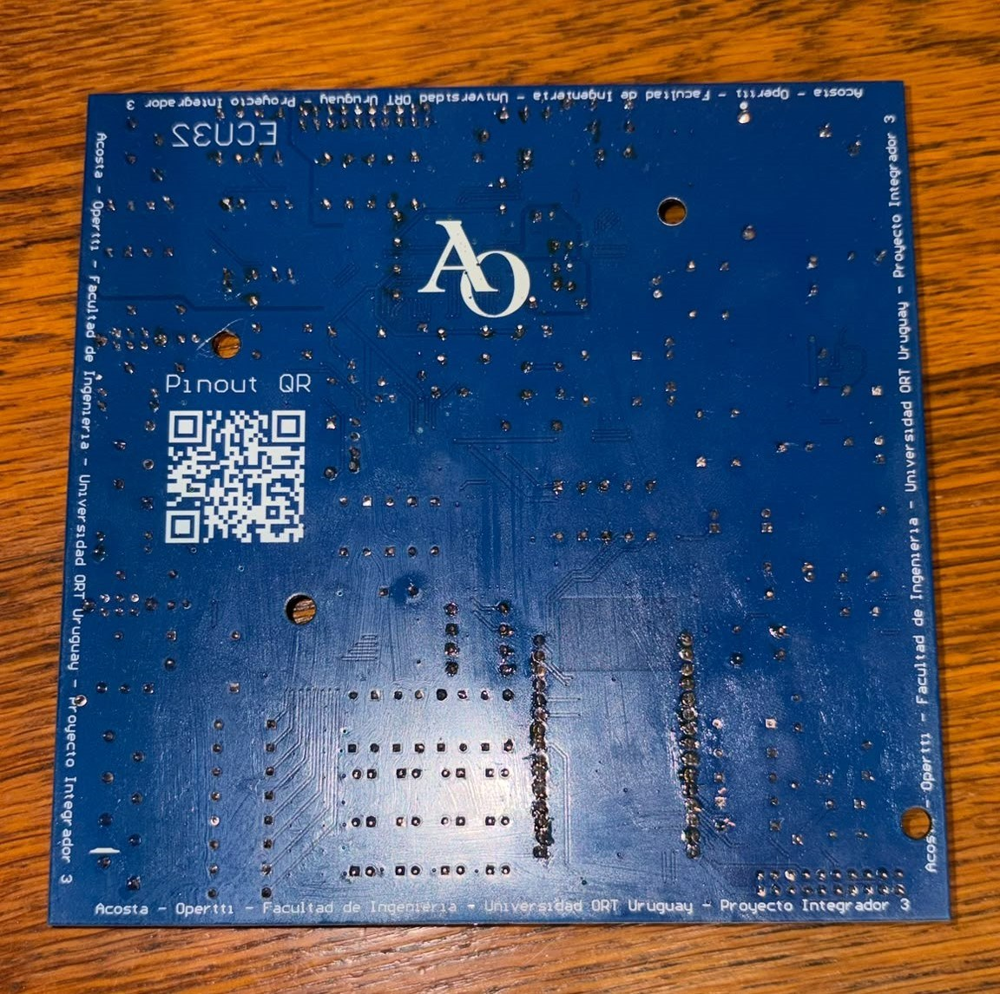
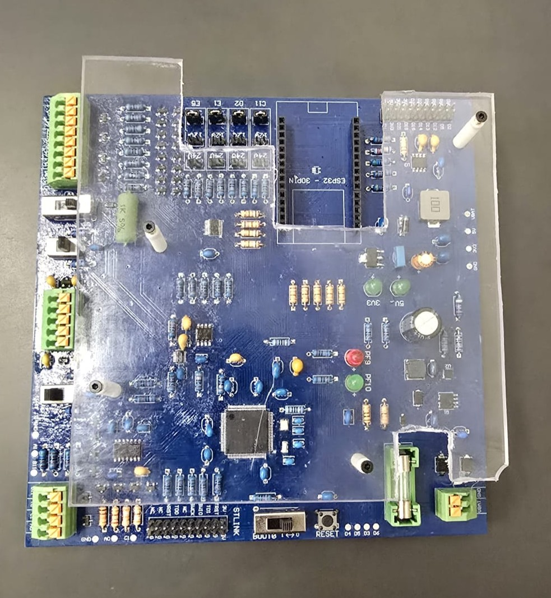
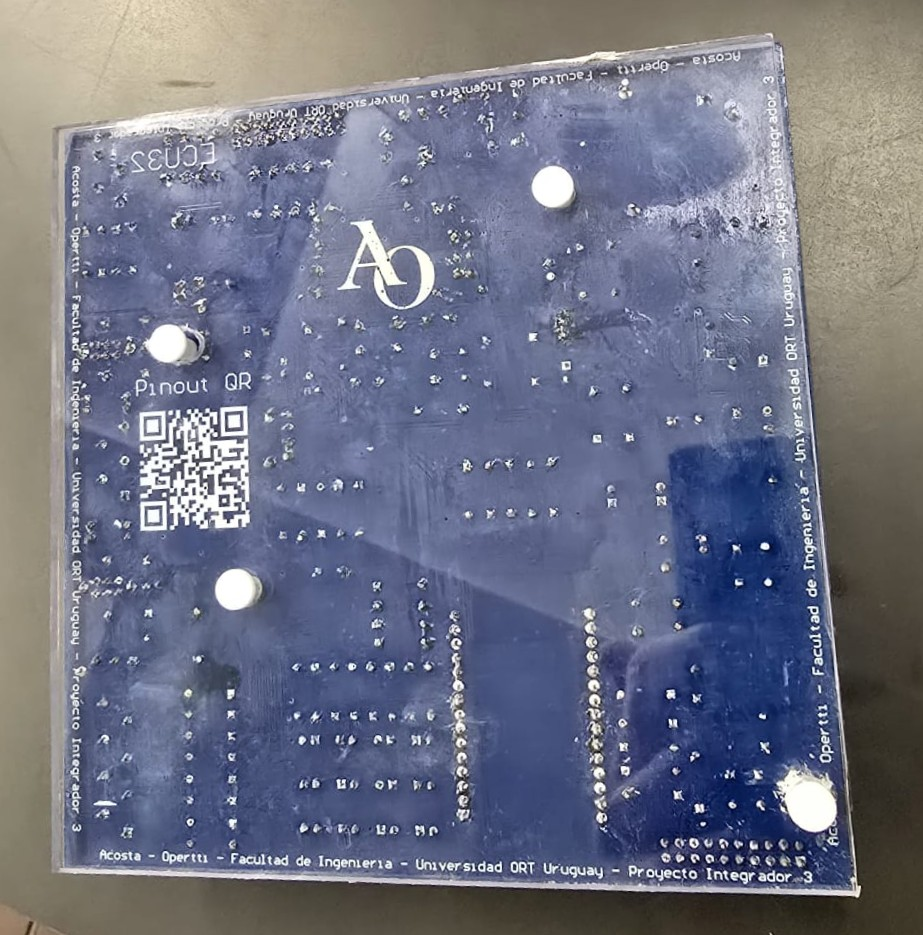
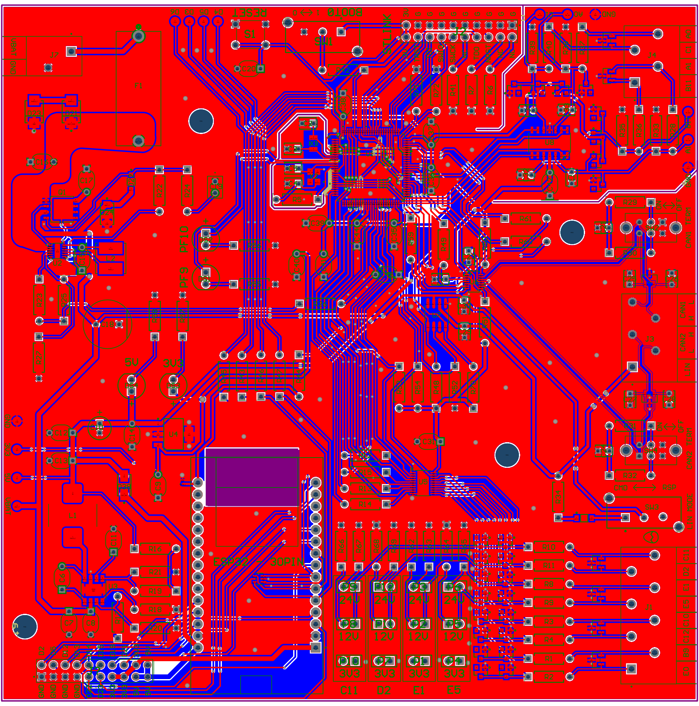
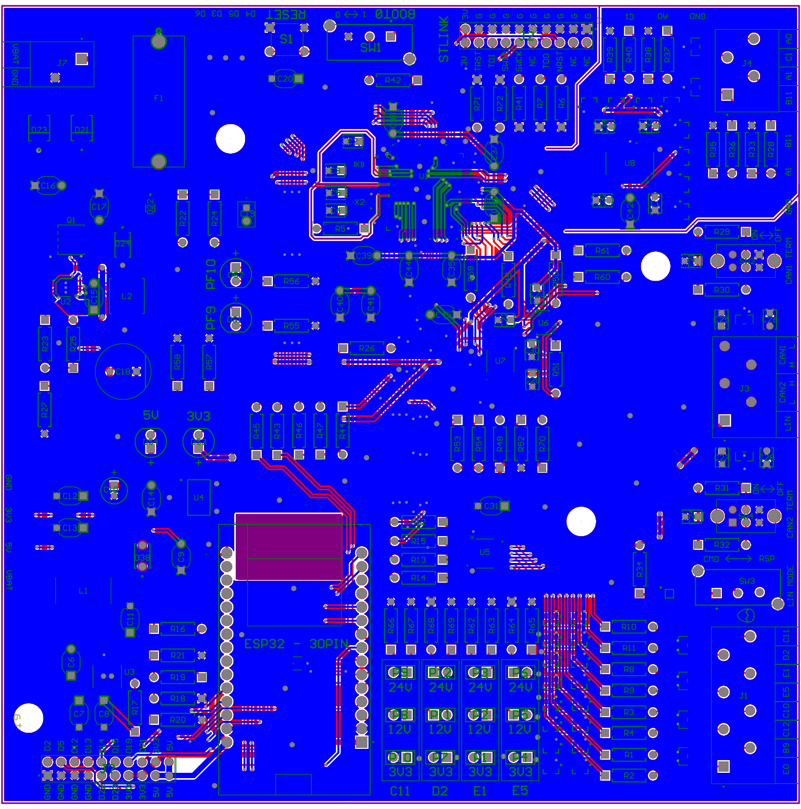

# ECU32

**ECU universal para vehículos de 12 / 24 V basada en STM32G491**
Proyecto Integrador 3 · Ingeniería en Electrónica · Universidad ORT Uruguay
Santiago Acosta · Mateo Opertti

<h2 align="center"><a href="#pinout">Ver pinout</a></h2>

<p align="center">
  <a href="hardware/schematic/ECU32_Schematic.pdf"><b>Esquemático</b></a> ·
  <a href="hardware/pcb/ECU32_PCB_Layout.pdf"><b>PCB Layout</b></a> ·
  <a href="#galería"><b>Fotos reales</b></a>
</p>

<p align="center">
  
</p>

ECU32 es una **ECU universal** para vehículos de 12 / 24 V: una placa de propósito general con CAN FD, LIN, entradas y salidas digitales y analógicas protegidas, y conectividad Wi-Fi/BLE. Se adapta a cada aplicación desde el firmware. Está pensada para el entorno automotriz, componentes AEC-Q100/Q200 y protecciónes contra transitorios ISO 16750-2 (cold crank y load dump).

---

## Contenido

- [Características](#características)
- [Diagrama de bloques](#diagrama-de-bloques)
- [Hardware](#hardware)
- [Gabinete](#gabinete)
- [Conectores](#conectores)
- [Pinout](#pinout)
- [Firmware](#firmware)
- [Estructura del repositorio](#estructura-del-repositorio)
- [Galería](#galería)
- [Estado del proyecto](#estado-del-proyecto)

---

## Características

| | |
|---|---|
| **MCU** | STM32G491VCT6: Cortex-M4F a 170 MHz, 256 KB de flash, LQFP100 |
| **Alimentación** | 12 V o 24 V nominal, con protección de polaridad inversa y sobretensión y TVS para load dump |
| **CAN FD** | 2 canales con terminación partida conmutable y wake-up por bus |
| **LIN** | 1 canal, con pull-up de master conmutable |
| **E/S digitales** | 4 DI y 4 DO protegidas, a través de un buffer con habilitación por grupo |
| **Entradas analógicas** | 4 canales con divisor, filtro RC, clamp y buffer op-amp |
| **Monitor de batería** | V_BAT medida por el ADC3 |
| **Conectividad** | Zócalo para ESP32-DEVKIT-V1 (Wi-Fi/BLE) conectado por UART |
| **Debug** | JTAG/SWD de 20 pines (ST-LINK, J-Link) |
| **PCB** | 2 capas, ~150 × 150 mm, fabricada en JLCPCB |

---

## Diagrama de bloques



---

## Hardware

| Bloque | Componente | Notas |
|---|---|---|
| Protección de entrada | F1, SMBJ58A + SMBJ28A, LM74720-Q1 + BUK7K15-80E | TVS en anti-serie e ideal diode con corte por OV (≈ 35 V) |
| Buck 5 V | AP64202SP-13 | |
| LDO 3,3 V | TLE42744GS-V33 | |
| MCU | STM32G491VCT6 | HSE de 16 MHz, LSE de 32,768 kHz |
| CAN FD | TCAN1046AVDYYRQ1 | VIO = 3,3 V; ESD con ESD2CAN36-Q1 |
| LIN | TLIN4029A-Q1 | Se maneja con el modo LIN del USART3 |
| E/S digitales | SN74LV244A | Por canal: R serie, zener, Schottky y TVS |
| Entradas analógicas | TLV9164 (seguidor) | Divisor distinto por canal (ver Pinout), 10 nF y clamps BAS40 |
| Wi-Fi / BLE | ESP32-DEVKIT-V1 (zócalo) | Se alimenta desde 5 V a través de un Schottky |

El esquemático tiene 7 hojas, una por bloque: STM32, GPIOs, alimentación, CAN, LIN, entradas analógicas y ESP32. Está todo en [`hardware/schematic/ECU32_Schematic.pdf`](hardware/schematic/ECU32_Schematic.pdf). El layout (top y bottom) está en [`hardware/pcb/ECU32_PCB_Layout.pdf`](hardware/pcb/ECU32_PCB_Layout.pdf) y el modelo 3D en [`hardware/3d/ECU32.step`](hardware/3d/ECU32.step).

---

## Gabinete

La placa se protege con tapas de acrílico superior e inferior, sostenidas por separadores impresos en 3D con insertos roscados M2 que pasan por los agujeros de Ø 5 mm de la PCB. Evitan cortocircuitos accidentales al manipular la placa energizada. El modelo y las medidas están en [`hardware/enclosure/`](hardware/enclosure/).

---

## Conectores

| Ref. | Función | Pines |
|---|---|---|
| J7 | Alimentación (batería) | 2 |
| J3 | CAN1, CAN2 y LIN | 5 |
| J1 | E/S digitales | 8 |
| J4 | Entradas analógicas | 4 |
| J2 | JTAG/SWD (ARM de 20 pines) | 20 |
| J5 / J6 | Headers para el ESP32 DevKit | — |

**J1, pines de la bornera:**

| Pin J1 | 1 | 2 | 3 | 4 | 5 | 6 | 7 | 8 |
|---|---|---|---|---|---|---|---|---|
| Señal | DO2 | DO1 | DO4 | DO3 | DI1 | DI2 | DI3 | DI4 |

**J3, CAN y LIN:**

| Pin J3 | 1 | 2 | 3 | 4 | 5 |
|---|---|---|---|---|---|
| Señal | LIN | CAN2_L | CAN2_H | CAN1_H | CAN1_L |

**J4, entradas analógicas:**

| Pin STM32 | B11 | A1 | C1 | A0 |
|---|---|---|---|---|
| Señal | AN1 | AN2 | AN3 | AN4 |
| Rango | 0 – 3,3 V | 0 – 5 V | 0 – 12 V | 0 – 24 V |

**J7, alimentación:** pin 1 = VBAT y pin 2 = GND.

**Llaves de configuración:** SW2 y SW4 conectan la terminación de cada bus CAN, y SW3 conecta el pull-up de master LIN.

---

## Pinout

> **QR de la serigrafía.** La cara inferior de la placa tiene un [QR con el pinout](docs/images/qr-pinout.png). Ese QR se generó antes de verificar la netlist y tiene dos errores: dice DO2 = PC10 y DO3 = PE0 (es al revés), y agrupa las /OE mezclando DI y DO (en realidad 1/OE controla DO1–DO4 y 2/OE controla DI1–DI4). **Las tablas de esta sección son las correctas.**

### Niveles de tensión por conector

| Conector | Señales | Nivel de trabajo | Protección |
|---|---|---|---|
| J7 | VBAT, GND | 12 V o 24 V nominal | Fusible, TVS en anti-serie, corte por sobretensión (≈ 35 V) y protección de polaridad inversa |
| J1 | DI1 – DI4 | **3,3 V, 12 V o 24 V**, según el jumper (ver abajo) | 4,7 kΩ en serie, zener de 4,7 V, Schottky y TVS de 36 V |
| J1 | DO1 – DO4 | Salida lógica de 3,3 V a través de 4,7 kΩ (señal, no potencia) | Zener de 4,7 V, Schottky y TVS de 36 V |
| J4 | AN1 | 0 – 3,3 V | Divisor resistivo y filtro RC, clamps Schottky a 3,3 V y GND, y TVS de 36 V |
| J4 | AN2 | 0 – 5 V | Ídem |
| J4 | AN3 | 0 – 12 V | Ídem |
| J4 | AN4 | 0 – 24 V | Ídem |
| J3 | CAN1, CAN2 | Niveles CAN FD estándar | ESD2CAN36-Q1 por bus |
| J3 | LIN | Nivel de batería (bus LIN estándar) | Propia del TLIN4029A-Q1 |

### Selección de tensión de las entradas digitales (jumpers)

Cada entrada digital tiene, cerca de J1, una columna de jumpers con tres posiciones: **3V3**, **12V** y **24V**. La serigrafía de cada columna indica el pin del MCU:

| Columna (serigrafía) | C11 | D2 | E1 | E5 |
|---|---|---|---|---|
| Entrada | DI4 | DI3 | DI2 | DI1 |

| Jumper | Divisor (4,7 kΩ en serie +) | Tensión en el buffer a fondo de escala |
|---|---|---|
| **3V3** | sin resistencia a GND | 3,3 V (entrada directa) |
| **12V** | 1,5 kΩ a GND | 12 V → 2,90 V |
| **24V** | 680 Ω a GND | 24 V → 3,03 V |

Poné **un solo jumper por canal**. Las entradas están protegidas por el zener de 4,7 V aunque el jumper no coincida con la tensión aplicada, pero la lectura sólo es correcta si la posición del jumper corresponde a la señal.

### Entradas y salidas digitales (U5 SN74LV244A)

**Entradas digitales** (el buffer maneja el pin del MCU; el pin siempre es entrada)

| Señal | Pin STM32 | Pin LQFP100 | Pin J1 | Funciones alternativas | EXTI |
|---|---|---|---|---|---|
| DI1 | PE5 | 4 | 5 | TIM3_CH4 (AF2, captura de entrada) | EXTI5 |
| DI2 | PE1 | 98 | 6 | USART1_RX (AF7), TIM17_CH1 (AF4), TIM20_CH4 (AF6) | EXTI1 |
| DI3 | PD2 | 84 | 7 | UART5_RX (AF5), TIM3_ETR (AF2, conteo de pulsos), TIM8_BKIN (AF4, corte de PWM por hardware) | EXTI2 |
| DI4 | PC11 | 80 | 8 | UART4_RX (AF5), SPI3_MISO (AF6) | EXTI11 |

**Salidas digitales** (el MCU maneja el buffer; el pin siempre es salida)

| Señal | Pin STM32 | Pin LQFP100 | Pin J1 | Funciones alternativas |
|---|---|---|---|---|
| DO1 | PB9 | 96 | 2 | TIM4_CH4 (AF2), TIM8_CH3 (AF10), TIM17_CH1 (AF1), TIM1_CH3N (AF12), IR_OUT (AF6), COMP2_OUT (AF8) |
| DO2 | PE0 | 97 | 1 | USART1_TX (AF7), TIM16_CH1 (AF4), TIM20_CH4N (AF3) |
| DO3 | PC10 | 79 | 4 | UART4_TX (AF5), SPI3_SCK (AF6), TIM8_CH1N (AF4) |
| DO4 | PC12 | 81 | 3 | UART5_TX (AF5), SPI3_MOSI (AF6), TIM8_CH3N (AF4) |

| Habilitación (activa en bajo) | Pin STM32 | Controla |
|---|---|---|
| 1/OE | PE8 | DO1 – DO4 |
| 2/OE | PE10 | DI1 – DI4 |

Las dos /OE tienen pull-up a 3,3 V, así que al reset el buffer queda en alta impedancia.

**Periféricos disponibles en J1:**

| Periférico | Salida (DO) | Entrada (DI) | Notas |
|---|---|---|---|
| USART1 | TX = DO2, PE0 (J1.1) | RX = DI2, PE1 (J1.6) | La usa la consola CP2102 del firmware de pruebas |
| UART4 | TX = DO3, PC10 (J1.4) | RX = DI4, PC11 (J1.8) | |
| UART5 | TX = DO4, PC12 (J1.3) | RX = DI3, PD2 (J1.7) | |
| SPI3 (solo maestro) | SCK = DO3, MOSI = DO4 | MISO = DI4 | Comparte pines con UART4 y con UART5_TX. CS por GPIO en DO1 o DO2 |
| PWM | TIM8: DO1 (CH3), DO3 (CH1N), DO4 (CH3N). TIM4_CH4 / TIM17_CH1: DO1. TIM16_CH1: DO2 | — | DI3 (TIM8_BKIN) puede cortar las PWM de TIM8 por hardware |

- Funciones del pin que **no** se pueden usar por J1: I2C (I2C3_SDA en PC11, I2C1_SDA en PB9), porque necesita una línea bidireccional open-drain y el buffer es unidireccional; los canales TIMx_CHxN en las DI (son salidas) y los ETR en las DO (son entradas); USART3_TX/RX (PB9, PC10, PC11), porque USART3 lo usa el LIN en PD8/PD9; FDCAN1_TX en PB9, porque FDCAN1 ya está en PA12.
- Para UART o cualquier señal de 3,3 V en una DI, el jumper de ese canal tiene que estar en 3V3. En 12V o 24V, el divisor deja la señal por debajo del umbral de alto.
- Las DO tienen 4,7 kΩ en serie: sirven para señal (UART, SPI, PWM, probado a 500 kHz en PC10), no para potencia.
- Los EXTI de las cuatro DI (5, 1, 2 y 11) son líneas distintas, así que se pueden usar las cuatro interrupciones a la vez.

### Entradas analógicas (ADC12)

| Señal | Pin STM32 | Canal ADC | Rango | R serie | R a GND | Factor V_conector / V_pin |
|---|---|---|---|---|---|---|
| AN1 | PB11 | ADC12_IN14 | 0 – 3,3 V | R36 = ‹completar› | R35 = ‹completar› | ‹completar› |
| AN2 | PA1 | ADC12_IN2 | 0 – 5 V | R28 = ‹completar› | R33 = ‹completar› | ‹completar› |
| AN3 | PC1 | ADC12_IN7 | 0 – 12 V | R40 = ‹completar› | R39 = ‹completar› | ‹completar› |
| AN4 | PA0 | ADC12_IN1 | 0 – 24 V | R37 = ‹completar› | R38 = ‹completar› | ‹completar› |

Factor = (R serie + R a GND) / R a GND. Fondo de escala = 3,3 V × factor.

> **El esquemático no está actualizado.** Los divisores de AN1 y AN2 se cambiaron en la placa armada (AN1 quedó de 0 a 3,3 V y AN2 de 0 a 5 V), pero el PDF del esquemático todavía muestra los valores anteriores. Para los rangos vale esta tabla.

### CAN FD (U6 TCAN1046AV-Q1)

| Señal | CAN1 | CAN2 |
|---|---|---|
| TX | PA12 (FDCAN1_TX, AF9) | PB6 (FDCAN2_TX, AF9) |
| RX | PA11 (FDCAN1_RX, AF9) | PB5 (FDCAN2_RX, AF9) |
| STB (alto = standby) | PD14 | PD15 |
| Wake-up | PE6 (WKUP3) | PC13 (WKUP2) |

### LIN (U7 TLIN4029A-Q1)

| Señal | Pin STM32 | Función |
|---|---|---|
| TXD | PD8 | USART3_TX (AF7) |
| RXD | PD9 | USART3_RX (AF7) |
| EN | PD10 | GPIO; pull-down, así que arranca en sleep |

### ESP32

| Señal ESP32 | Pin STM32 | Función |
|---|---|---|
| RX2 | PD5 | USART2_TX (AF7) |
| TX2 | PD6 | USART2_RX (AF7) |
| D4 | PD4 | GPIO |
| D18 | PD3 | GPIO |
| EN | PE7 | GPIO open-drain |

### Internos, relojes y debug

| Función | Pin STM32 |
|---|---|
| Monitor de batería (V_BAT = 21,8 × V_PE9) | PE9 (ADC3_IN2) |
| LED1 (DS1) | PF9 |
| LED2 (DS2) | PF10 |
| HSE 16 MHz | PF0 / PF1 |
| LSE 32,768 kHz | PC14 / PC15 |
| JTAG / SWD | PA13, PA14, PA15, PB3, PB4 |
| BOOT0 | PB8 |
| Pull-down UCPD (deshabilita el *dead battery*) | PA9, PA10 |

---

## Firmware

Las pruebas del bring-up están en [`firmware/`](firmware/), escritas a nivel de registros (sin HAL). Se graba un único firmware, [`Universal.c`](firmware/Apps/Universal.c), igual en las dos placas: la prueba se elige desde una terminal serie (USART1 por J1, con un adaptador USB-UART) o, en la placa esclava, desde la maestra por CAN2. Los programas sueltos de cada prueba siguen en [`Apps/legacy/`](firmware/Apps/legacy/).

| Prueba | Qué prueba | Cómo se ve que funciona |
|---|---|---|
| `leds` | LED1 (PF9) y LED2 (PF10) | Parpadean cada 500 ms |
| `digital` | Entrada DI4 (PC11) | Verde en alto, rojo en bajo |
| `salidas` | Salida DO3 (PC10) | Salida en alto y LED verde |
| `loopback` | Lazo salida DO3 → entrada DI4 | La consola informa OK o FALLA en cada lectura |
| `adc` | AN1 – AN4 (ADC1) | Tensión por la consola y LEDs por umbral. `an_mv[]` es la tensión en el pin del MCU: para obtener la del conector J4 hay que multiplicarla por el factor de cada canal (ver [Entradas analógicas](#entradas-analógicas-adc12)) |
| `pwm` | PWM de 500 kHz por PC10 (TIM8_CH1N) | Duty ajustable con el comando `duty` |
| `esp32` | USART2 hacia la ESP32 del zócalo | El LED de la ESP32 sigue al verde |
| `can_fd` | FDCAN1 → FDCAN2, 500 kbit/s / 2 Mbit/s, 64 bytes | Verde alterna con cada trama correcta |
| `can_maestro` / `can_esclavo` | CAN FD entre dos placas por CAN1 | Verde o juego de luces con cada trama correcta |
| `wakeup` | Despertar desde Standby por CAN1 o CAN2 | Rojo 3 s, se duerme; despierta con el verde cada 250 ms |
| `lin_maestro` / `lin_esclavo` | LIN 2.x a 19200 baud entre dos placas | Verde alterna con cada trama correcta |

En el [README del firmware](firmware/README.md) están los comandos, las conexiones de cada prueba, el protocolo CAN2 y cómo compilar y grabar.

**Herramientas:** VS Code con la extensión STM32Cube (CMake + Ninja, GCC 14.3.1) y un ST-LINK conectado a J2. La placa no tiene USB propio; siempre se alimenta por J7.

### Notas de arranque

Puntos que hay que configurar sí o sí en el código de inicialización:

1. **Debug:** dejar el JTAG completo habilitado (PA15, PB3 y PB4 están cableados a J2).
2. **Relojes:** los programas de prueba usan el HSI16 por defecto. Para la aplicación final están el HSE de 16 MHz (que ya usa `CAN_FD.c`) y el LSE de 32,768 kHz; si el LSE no arranca, ajustar `LSEDRV`.
3. **Buffer de E/S y consola:** PE8 y PE10 arrancan en alto. La consola (USART1) pasa por U5, así que el orden es: DO1 (PB9), DO3 (PC10) y DO4 (PC12) como salidas en bajo; USART1 habilitado (UE, TE, RE) con PE0/PE1 en AF7, para que el TX quede en reposo en alto; bajar PE8 (1/OE) y después bajar PE10 (2/OE). Desde ahí los /OE quedan en bajo: ninguna prueba los vuelve a subir.
4. **CAN:** poner PD14 y PD15 en bajo para sacar los transceptores de standby.
5. **LIN:** poner PD10 en alto antes de transmitir. USART3 en modo LIN (`LINEN`).
6. **ESP32:** manejar PE7 como open-drain, porque el DevKit ya tiene su propio pull-up en EN.
7. **Wake-up por CAN:** WKUP3 (PE6) desde CAN1 y WKUP2 (PC13) desde CAN2.

---

## Estructura del repositorio

```
ECU32/
├── hardware/
│   ├── schematic/         Esquemático en PDF (7 hojas) + netlist PI_3.NET
│   ├── pcb/               Layout en PDF (top y bottom)
│   ├── 3d/                Modelo 3D de la placa (STEP)
│   ├── enclosure/         Separadores impresos en 3D para el gabinete (STL)
│   ├── fabrication/       Gerbers y NC Drill enviados a JLCPCB (zip)
│   └── bom/               BOM (CSV y Excel)
├── firmware/              Proyecto CMake (STM32Cube para VS Code)
│   ├── Apps/              Programas de prueba, uno por periférico
│   ├── Src/               main.c (selector de programa), startup y syscalls
│   └── cmake/             Toolchain y flags
├── docs/
│   ├── images/
│   │   ├── diagrams/      Diagrama de bloques inicial (PNG + fuente .cddx)
│   │   ├── renders/       Renders 3D
│   │   ├── pcb/           Capturas del layout
│   │   └── photos/        Fotos de la placa armada y del separador
│   ├── manual/            Manual de usuario UM-ECU32                     [pendiente]
│   └── reports/           Anteproyecto (informe final pendiente)
└── README.md
```

Las carpetas marcadas como *pendiente* todavía sólo tienen un `README.md` que explica qué va adentro y cómo exportarlo desde Altium.

---

## Galería

| Placa armada (top) | Placa armada (bottom) |
|---|---|
|  |  |

| Placa en el gabinete (top) | Placa en el gabinete (bottom) |
|---|---|
|  |  |

**[Ver el video de la placa](docs/images/photos/ecu32-video.mp4)**


| Layout top | Layout bottom |
|---|---|
|  |  |

---

## Estado del proyecto

| Etapa | Estado |
|---|---|
| Esquemático | Terminado |
| PCB layout | Terminado, fabricado por JLCPCB en octubre de 2026 |
| Componentes | Recibidos |
| Armado | Placa armada |
| Gabinete | Separadores impresos en 3D |
| Bring-up | En curso |
| Firmware | En curso: programas de prueba por periférico listos |
| Entrega final | 30/11/2026 |

---

## Equipo

Diseñado y desarrollado en conjunto por:

- **Santiago Acosta**
- **Mateo Opertti**

Proyecto Integrador 3, Universidad ORT Uruguay, 2026.
