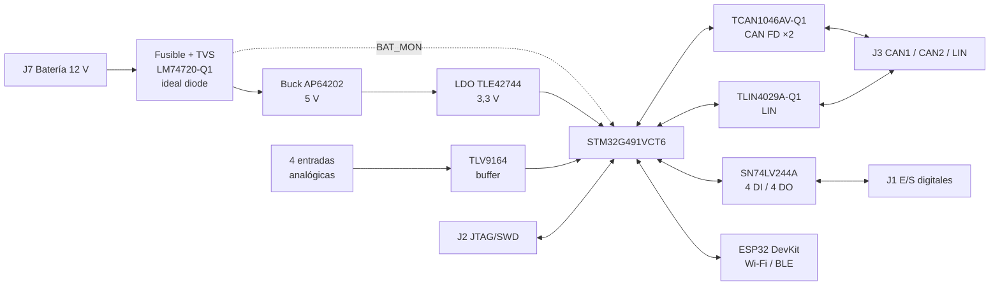

# ECU32

**ECU universal para vehículos de 12 V basada en STM32G491**
Proyecto Integrador 3 · Ingeniería en Electrónica · Universidad ORT Uruguay
Santiago Acosta · Mateo Opertti

<p align="center">
  
</p>

<p align="center">
  <a href="#pinout"><b>Pinout</b></a> ·
  <a href="hardware/schematic/ECU32_Schematic_Rev1.0.pdf"><b>Esquemático (PDF)</b></a> ·
  <a href="hardware/pcb/ECU32_PCB_Layout_Rev1.0.pdf"><b>PCB Layout (PDF)</b></a> ·
  <a href="hardware/schematic/PI_3.NET"><b>Netlist</b></a>
</p>

ECU32 reúne en un solo nodo dos funciones que normalmente están en ECUs separadas: un **BMS**, que es relevante para la seguridad, y un **control de clima**, que no es crítico. Con eso buscamos bajar la cantidad de ítems del BOM, el peso del arnés y el costo total. La placa está pensada para el entorno automotriz:

- componentes AEC-Q100/Q200;
- protección contra transitorios ISO 16750-2 (cold crank y load dump);
- consumo en sleep menor a 100 µA usando Standby + RTC.

---

## Contenido

- [Características](#características)
- [Diagrama de bloques](#diagrama-de-bloques)
- [Hardware](#hardware)
- [Conectores](#conectores)
- [Pinout](#pinout)
- [Firmware: notas de arranque](#firmware-notas-de-arranque)
- [Estructura del repositorio](#estructura-del-repositorio)
- [Galería](#galería)
- [Estado del proyecto](#estado-del-proyecto)

---

## Características

| | |
|---|---|
| **MCU** | STM32G491VCT6: Cortex-M4F a 170 MHz, 256 KB de flash, LQFP100 |
| **Alimentación** | 12 V nominal, con protección de polaridad inversa y sobretensión y TVS para load dump |
| **CAN FD** | 2 canales con terminación partida conmutable y wake-up desde Standby |
| **LIN** | 1 canal, con pull-up de master conmutable |
| **E/S digitales** | 4 DI y 4 DO protegidas, a través de un buffer con habilitación por grupo |
| **Entradas analógicas** | 4 canales con divisor, filtro RC, clamp y buffer op-amp |
| **Monitor de batería** | V_BAT medida por el ADC3 |
| **Conectividad** | Zócalo para ESP32-DEVKIT-V1 (Wi-Fi/BLE) conectado por UART |
| **Debug** | JTAG/SWD de 20 pines (ST-LINK, J-Link) |
| **PCB** | 2 capas, ~150 × 150 mm, fabricada en JLCPCB |

---

## Diagrama de bloques



---

## Hardware

| Bloque | Componente | Notas |
|---|---|---|
| Protección de entrada | F1, SMBJ58A + SMBJ28A, LM74720-Q1 + BUK7K15-80E | TVS en anti-serie e ideal diode con corte por OV (≈ 35 V) |
| Buck 5 V | AP64202SP-13 | Modo PFM para bajo IQ |
| LDO 3,3 V | TLE42744GS-V33 | |
| MCU | STM32G491VCT6 | HSE de 16 MHz, LSE de 32,768 kHz |
| CAN FD | TCAN1046AVDYYRQ1 | VIO = 3,3 V; ESD con ESD2CAN36-Q1 |
| LIN | TLIN4029A-Q1 | Se maneja con el modo LIN del USART3 |
| E/S digitales | SN74LV244A | Por canal: R serie, zener, Schottky y TVS |
| Entradas analógicas | TLV9164 (seguidor) | Por canal: 5,6 k / 8,2 k, 10 nF y clamps BAS40 |
| Wi-Fi / BLE | ESP32-DEVKIT-V1 (zócalo) | Se alimenta desde 5 V a través de un Schottky |

El esquemático tiene 7 hojas, una por bloque: STM32, GPIOs, alimentación, CAN, LIN, entradas analógicas y ESP32. Está todo en [`hardware/schematic/ECU32_Schematic_Rev1.0.pdf`](hardware/schematic/ECU32_Schematic_Rev1.0.pdf). El layout (top y bottom) está en [`hardware/pcb/ECU32_PCB_Layout_Rev1.0.pdf`](hardware/pcb/ECU32_PCB_Layout_Rev1.0.pdf).

---

## Conectores

| Ref. | Función | Pines |
|---|---|---|
| J7 | Alimentación (batería) | 2 |
| J3 | CAN1, CAN2 y LIN | 5 |
| J1 | E/S digitales | 8 |
| J4 | Entradas analógicas | 4 |
| J2 | JTAG/SWD (ARM de 20 pines) | 20 |
| J5 / J6 | Headers para el ESP32 DevKit | — |

**J1, pines de la bornera:**

| Pin J1 | 1 | 2 | 3 | 4 | 5 | 6 | 7 | 8 |
|---|---|---|---|---|---|---|---|---|
| Señal | DO2 | DO1 | DO4 | DO3 | DI1 | DI2 | DI3 | DI4 |

**J3, CAN y LIN:**

| Pin J3 | 1 | 2 | 3 | 4 | 5 |
|---|---|---|---|---|---|
| Señal | LIN | CAN2_L | CAN2_H | CAN1_H | CAN1_L |

**J4, entradas analógicas:**

| Pin J4 | 1 | 2 | 3 | 4 |
|---|---|---|---|---|
| Señal | AN1 | AN2 | AN3 | AN4 |

**J7, alimentación:** pin 1 = VBAT y pin 2 = GND.

**Llaves de configuración:** SW2 y SW4 conectan la terminación de cada bus CAN, y SW3 conecta el pull-up de master LIN.

---

## Pinout

> La fuente de verdad es el netlist `PI_3.NET`. Algunos nombres de net del esquemático de Altium no coinciden con el pin real del MCU. Ante cualquier duda, gana el netlist.

### Entradas y salidas digitales (U5 SN74LV244A)

| Señal | Pin STM32 | Pin LQFP100 | | Señal | Pin STM32 | Pin LQFP100 |
|---|---|---|---|---|---|---|
| DI1 | PE5 | 4 | | DO1 | PB9 | 96 |
| DI2 | PE1 | 98 | | DO2 | PE0 | 97 |
| DI3 | PD2 | 84 | | DO3 | PC10 | 79 |
| DI4 | PC11 | 80 | | DO4 | PC12 | 81 |

| Habilitación (activa en bajo) | Pin STM32 | Controla |
|---|---|---|
| 1/OE | PE8 | DO1 – DO4 |
| 2/OE | PE10 | DI1 – DI4 |

Las dos /OE tienen pull-up a 3,3 V, así que al reset el buffer queda en alta impedancia.

### Entradas analógicas (ADC12)

| Señal | Pin STM32 | Canal ADC |
|---|---|---|
| AN1 | PB11 | ADC12_IN14 |
| AN2 | PA1 | ADC12_IN2 |
| AN3 | PC1 | ADC12_IN7 |
| AN4 | PA0 | ADC12_IN1 |

### CAN FD (U6 TCAN1046AV-Q1)

| Señal | CAN1 | CAN2 |
|---|---|---|
| TX | PA12 (FDCAN1_TX, AF9) | PB6 (FDCAN2_TX, AF9) |
| RX | PA11 (FDCAN1_RX, AF9) | PB5 (FDCAN2_RX, AF9) |
| STB (alto = standby) | PD14 | PD15 |
| Wake-up | PE6 (WKUP3) | PC13 (WKUP2) |

### LIN (U7 TLIN4029A-Q1)

| Señal | Pin STM32 | Función |
|---|---|---|
| TXD | PD8 | USART3_TX (AF7) |
| RXD | PD9 | USART3_RX (AF7) |
| EN | PD10 | GPIO; pull-down, así que arranca en sleep |

### ESP32

| Señal ESP32 | Pin STM32 | Función |
|---|---|---|
| RX2 | PD5 | USART2_TX (AF7) |
| TX2 | PD6 | USART2_RX (AF7) |
| D4 | PD4 | GPIO |
| D18 | PD3 | GPIO |
| EN | PE7 | GPIO open-drain |

### Internos, relojes y debug

| Función | Pin STM32 |
|---|---|
| Monitor de batería (V_BAT = 21,8 × V_PE9) | PE9 (ADC3_IN2) |
| LED1 (DS1) | PF9 |
| LED2 (DS2) | PF10 |
| HSE 16 MHz | PF0 / PF1 |
| LSE 32,768 kHz | PC14 / PC15 |
| JTAG / SWD | PA13, PA14, PA15, PB3, PB4 |
| BOOT0 | PB8 |
| Pull-down UCPD (deshabilita el *dead battery*) | PA9, PA10 |

---

## Firmware: notas de arranque

Puntos que hay que configurar sí o sí en CubeMX o en el código de inicialización:

1. **Debug:** dejar el JTAG completo habilitado (PA15, PB3 y PB4 están cableados a J2).
2. **Relojes:** HSE de 16 MHz y LSE de 32,768 kHz. Si el LSE no arranca, ajustar `LSEDRV`.
3. **Buffer de E/S:** PE8 y PE10 arrancan en alto. Después: fijar niveles seguros en las DO, bajar 1/OE y luego bajar 2/OE.
4. **CAN:** poner PD14 y PD15 en bajo para sacar los transceptores de standby.
5. **LIN:** poner PD10 en alto antes de transmitir. USART3 en modo LIN (`LINEN`).
6. **ESP32:** manejar PE7 como open-drain, porque el DevKit ya tiene su propio pull-up en EN.
7. **Bajo consumo:** Standby + RTC, con wake-up por WKUP3 (CAN1) y WKUP2 (CAN2).

Herramientas: STM32CubeIDE, STM32CubeMX, STM32CubeProgrammer y STM32CubeG4 (HAL/LL). La placa no tiene USB propio; siempre se alimenta por J7.

---

## Estructura del repositorio

```
ECU32/
├── hardware/
│   ├── schematic/         Esquemático en PDF (7 hojas) + netlist PI_3.NET
│   ├── pcb/               Layout en PDF (top y bottom)
│   ├── 3d/                Modelo 3D de la placa (STEP)
│   ├── fabrication/       Gerbers, NC Drill y Pick & Place enviados a JLCPCB
│   └── bom/               BOM con links a DigiKey
├── firmware/              Proyecto STM32CubeIDE
├── docs/
│   ├── images/
│   │   ├── renders/       Renders 3D para el README
│   │   ├── pcb/           Capturas del layout
│   │   └── photos/        Fotos de la placa armada y de las pruebas
│   ├── manual/            Manual de usuario UM-ECU32
│   └── reports/           Anteproyecto e informe final
└── README.md
```

Cada carpeta tiene su propio `README.md` que explica qué va adentro y cómo exportarlo desde Altium. Las carpetas que todavía no tienen archivos sólo contienen ese README.

---

## Galería

| Layout top | Layout bottom |
|---|---|
|  |  |

<!-- Descomentá a medida que agregues renders y fotos:

| Render 3D | Placa armada |
|---|---|
|  |  |
-->

*Próximamente: renders 3D y fotos de la placa armada.*

---

## Estado del proyecto

| Etapa | Estado |
|---|---|
| Esquemático | Terminado (Rev 1.0) |
| PCB layout | Terminado (Rev 1.0), enviado a JLCPCB en octubre de 2026 |
| Componentes | Recibidos |
| Armado y bring-up | En curso |
| Firmware | En curso |
| Entrega final | 30/11/2026 |

### Limitaciones conocidas de la Rev 1.0

- El grado de temperatura del MCU (sufijo 6) es −40…85 °C ambiente.
- El divisor de BAT_MON tiene un consumo permanente de ~100 µA, lo que compromete el objetivo de IQ en sleep.
- El TLV9164 de las entradas analógicas se alimenta desde 5 V. Para la próxima revisión se evalúa pasarlo a 3,3 V.

---

## Equipo

Diseñado y desarrollado en conjunto por:

- **Santiago Acosta**
- **Mateo Opertti**

Proyecto Integrador 3, Universidad ORT Uruguay, 2026.
