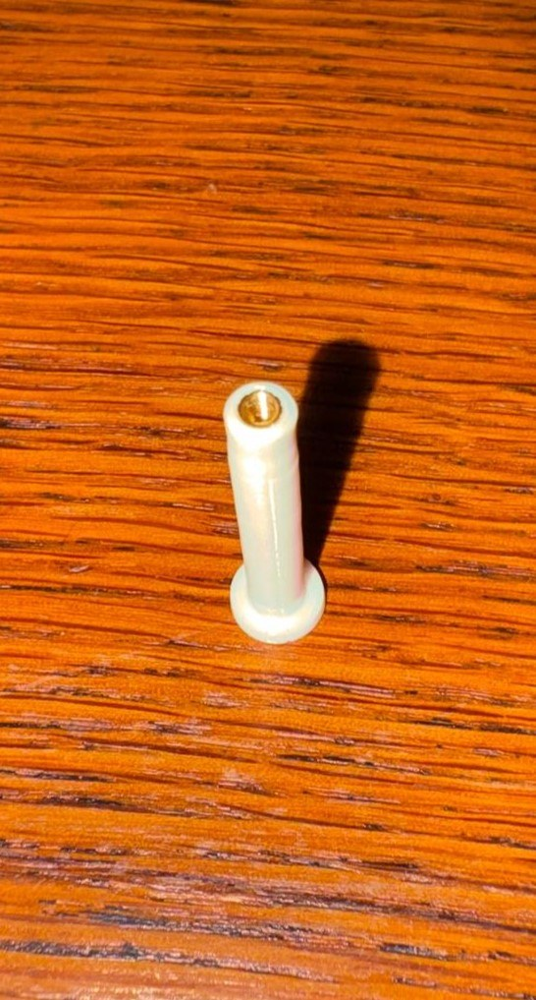

# Gabinete de acrílico: separadores impresos en 3D

| Archivo | Contenido |
|---|---|
| [`separador.stl`](separador.stl) | Separador que sostiene las tapas de acrílico (Fusion 360, en mm) |

  

## Qué son

Piezas impresas en 3D que pasan por los **agujeros de Ø 5 mm de la PCB** y sostienen las **tapas de acrílico** superior e inferior. Cada una tiene una brida en un extremo y un **inserto roscado M2 de bronce** en el otro, donde se atornilla la tapa con un tornillo M2.

| Medida | Valor |
|---|---|
| Largo total | 34 mm (brida de 2 mm + fuste de 32 mm) |
| Diámetro del fuste | 4,6 mm (entra en el agujero de Ø 5 mm) |
| Diámetro de la brida | 7,5 mm |
| Alojamiento del inserto | Ø 2,8 mm × 5 mm de profundidad |
| Inserto | M2 de bronce (Kadrick), colocado en caliente: Ø 3,0 mm en el moleteado, Ø 2,7 mm en la base, 4 mm de largo |

## Para qué sirven

Cumplen el ítem del **Nivel Extendido** del [anteproyecto](../../docs/reports/Anteproyecto.pdf): *"Gabinete de acrílico, que permite manipular la placa energizada sin riesgo de cortocircuito accidental contra los conductores expuestos"*. Las tapas evitan que una punta, un cable o una herramienta toque las soldaduras o los nodos expuestos con la placa alimentada.

Al ser plásticos, no conducen y no conectan nada a GND. Los tornillos apoyan sobre el acrílico, nunca sobre el cobre.

> Es una protección de laboratorio, **no un gabinete automotriz**: no tiene grado IP ni calificación de vibración o temperatura.

## Cómo fabricarlos

1. Abrir `separador.stl` en Cura (u otro slicer) e imprimir parado, con la brida apoyada en la cama.
2. Colocar el inserto en caliente, con el soldador a la temperatura del plástico, empujando recto hasta que quede al ras.
